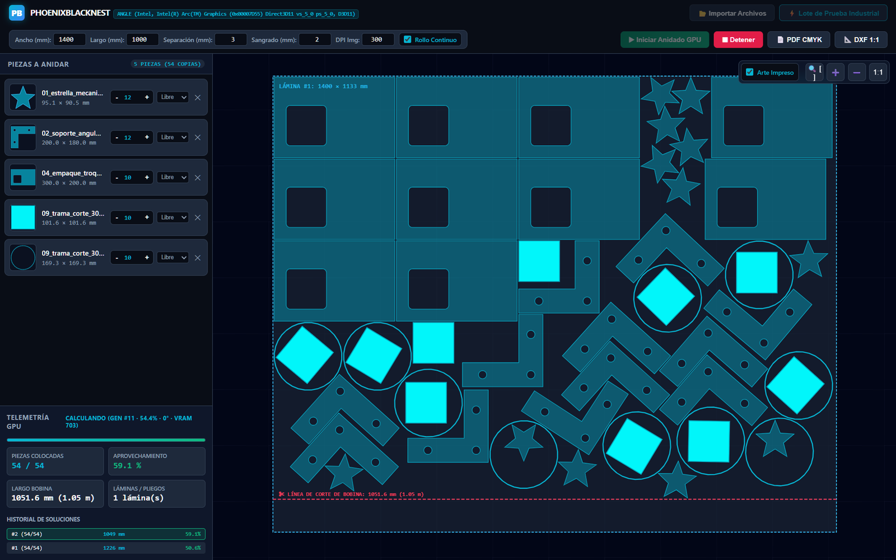
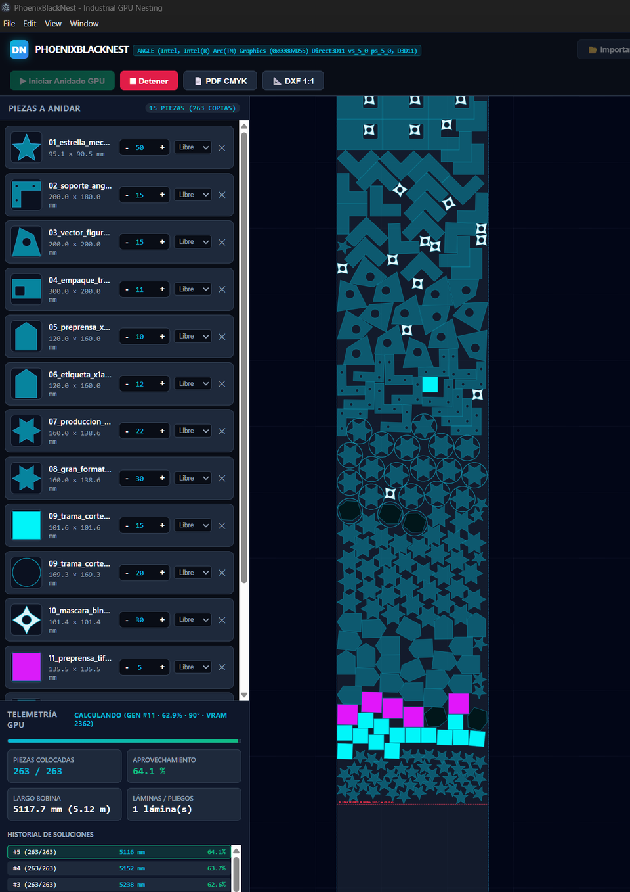

# PhoenixBlackNest

**GPU true-shape nesting for industrial cutting.** Reads DXF/DWG/SVG/PDF and images, extracts the real contour of every part (holes included), packs them onto fixed sheets or a continuous roll without overlap, and exports DXF 1:1 mm plus print-ready imposition PDFs.



*A real production run: 14 references, 263 copies, one 5.12 m roll at 64.1 %.*



- Website: [docs/index.html](docs/index.html)
- License: **AGPL-3.0** — see [LICENSE](LICENSE)

## Quick start

Needs Windows x64, a GPU with WebGL2 (D3D11) and Python 3.10+.

```bat
git clone https://github.com/PhoenixWally/PhoenixBlack-Nest.git
cd PhoenixBlack-Nest
npm install
python -m pip install shapely ezdxf reportlab pillow numpy opencv-python-headless pymupdf pypdf
run.bat
```

`run.bat` verifies `node_modules`, exports `PYTHONUTF8`/`PYTHONNOUSERSITE`, uses a bundled
`runtime\python` if present, and prints the Electron exit code if anything fails.
`npm start` does the same without the checks.

**Single-file .exe** (no Node.js on the target machine):

```bat
npm install
npm run dist
```

Produces `dist\PhoenixBlackNest-2.0.0-portable.exe` (~96 MB, portable, no installer). The
target machine still needs Python 3.10+ with the packages above — or set
`PHOENIXBLACKNEST_PYTHON` to a python.exe, or ship a `runtime\python` folder inside the
build so it is embedded.

## The problem

Manual CAD nesting wastes material: parts are placed by bounding box, holes and islands are ignored, and the gaps between complex shapes are thrown away. Worse, verifying that two parts never touch is an expensive geometric test that a sequential loop cannot run hundreds of thousands of times per second.

## What it does

1. **True-shape intake** — DXF (LINE/ARC/SPLINE/LWPOLYLINE with topological stitching), DWG (via ODA File Converter if installed), SVG (transforms, curves, `use`), vector PDF, and rasters (PNG/JPG/TIFF/WEBP/BMP) with silhouette detection.
2. **Contour hierarchy** — outer boundary, holes and islands are kept apart, and every part is normalized to real millimeters.
3. **GPU evaluation** — a WebGL2 engine rasterizes the sheet and all parts into a 2048×1024 ping-pong buffer, evaluates up to 8 parts per pass with 96 samples per part, and prunes doomed pixels inside the shader.
4. **Slide to contact** — each candidate is slid until it touches the geometry already placed, honoring the exact `spacing`.
5. **Genetic search** — selection, 1° rotation steps, and a fine window around the best candidates.
6. **Sheets or roll** — multi-sheet layouts, or a continuous roll with an incrementally extended occupancy grid.
7. **Export** — DXF with closed `LWPOLYLINE` on the `CutContour` layer (`$INSUNITS=4`) and an imposition PDF with cut marks and bleed.

## Measured performance

| Metric | Value |
|---|---|
| Roll utilization (real batch, 144 parts) | 72.2 % |
| Fixed-sheet utilization (audit set, 180 parts, 24 complex shapes) | 54.3 % |
| Material overlap | 0.000000 mm² |
| Minimum clearance | 3.0000 mm (configured spacing) |
| Batch evaluation cost | 3.78 ms |
| Search rate | 4.23 s/gen (sheets) · 4.96 s/gen (roll) |

Measured on Windows 11 with an Intel Arc GPU; results depend on the machine and the shape mix.

## Requirements

- Windows x64
- **GPU with WebGL2 / D3D11** — the nesting engine runs in a hidden GPU worker; without a working GPU driver the engine cannot start
- Node.js 18+ and npm (for Electron)
- Python 3.10+ (3.13 tested) with `shapely ezdxf reportlab pillow numpy opencv-python-headless pymupdf pypdf`

```bat
npm install
python -m pip install shapely ezdxf reportlab pillow numpy opencv-python-headless pymupdf pypdf
```

## Usage

```bat
run.bat
```

or

```bat
npm start
```

1. **Import** — drag or pick DXF/DWG/SVG/PDF/images. Each file is converted to contours in millimeters, with detected vertices and holes.
2. **Configure** — sheet size or roll mode, `spacing`, bleed, copies per part and rotation step.
3. **Nest** — the engine runs in a hidden GPU worker and reports every generation. Stop it at any time.
4. **Export** — DXF 1:1 mm (`CutContour`) and imposition PDF.

Environment variables:

| Variable | Purpose |
|---|---|
| `PHOENIXBLACKNEST_PYTHON` | Python interpreter to use |
| `NEST_SAMPLES` | Sample folder for the tests |
| `MODE`, `GEN` | Mode and generation count for `tests/test_audit_180.js` |

## Tests

```bat
node_modules\electron\dist\electron.exe tests\test_precision_1deg.js
node_modules\electron\dist\electron.exe tests\test_real_stress.js
node_modules\electron\dist\electron.exe tests\test_roll.js
```

Reproducible benchmark (same seed, same instance, per-run GPU counters):

```bat
set NEST_SAMPLES=D:\path\to\dxf_batch\
set PBN_SEED=12345
set DUR=25000
node_modules\electron\dist\electron.exe tests\bench_engine.js
```

The engine accepts `seed` (deterministic ordering and angle exploration), so two runs
with the same seed and inputs produce the same layout. `bench_engine.js` prints per-run
generation throughput, utilisation and GPU batch/readback timings.

The test scripts load parts from `samples\` unless `NEST_SAMPLES` points elsewhere:
a missing folder fails with `ENOENT: scandir ...\samples\`, so create it or set the variable.

## Troubleshooting

| Symptom | Cause / fix |
|---|---|
| Second launch shows no window | Only one instance can run per user profile (GPU state is shared). The second launch focuses the first; kill any leftover `PhoenixBlackNest.exe`/`electron.exe` if one is stuck. |
| Blank window | Check the console for `[UI] did-fail-load` (a retry is automatic) and `[UNCAUGHT]`. |
| `[GPU Worker] render-process-gone` | Driver reset or GPU memory pressure; the worker reloads itself after 800 ms. Reduce evaluator size if it repeats. |
| `ENOENT ... python.exe` | Python not on `PATH`: install it, or set `PHOENIXBLACKNEST_PYTHON` to the interpreter, or drop a runtime in `runtime\python\python.exe`. |
| `ModuleNotFoundError: No module named 'fitz'` (or `shapely`, `ezdxf`…) while every `pip install` succeeded | The packages live in the per-user site-packages (`%APPDATA%\Python\Python3xx\site-packages`) and the process inherited `PYTHONNOUSERSITE=1`. The app clears that variable for every Python call and runs a dependency preflight at startup that names the missing modules and prints the exact `pip install` command. |
| `ENOENT ... samples\` when running tests | Set `NEST_SAMPLES` to a folder with `01_*.dxf` … `14_*` files, or create `samples\`. |
| Ported/packaged build cannot find Python | Packaged builds cannot read `.py` from inside `app.asar`; they are unpacked to `app.asar.unpacked` automatically. Python itself must exist on the machine or in `runtime\python`. |

## Packaging

`npm run dist` builds the portable `.exe`; `npm run dist:installer` builds an NSIS
installer instead. The build embeds `main.js`, `ui/`, `worker/` and `engine/` (with the
Python scripts unpacked outside the asar) and is verified with
`dist\win-unpacked\PhoenixBlackNest.exe --test-e2e`, which writes
`%TEMP%\phoenixblacknest_e2e_report.json` (`"passed": true` when GPU, both nesting modes
and DXF/PDF export work).

## Architecture

```
main.js                          Electron main process (windows, IPC, Python)
worker/gpu_worker.html           hidden GPU worker (WebGL2)
worker/engine_bridge.js          worker IPC bridge
engine/universal_gpu_engine.js   rasterization, evaluation, part mining
engine/core_nesting_engine.js    GA, sheets, roll, compaction, occupancy
engine/local_cad_converter.py    DXF/DWG/SVG/PDF/raster intake
engine/pdf_imposition_exporter.py DXF 1:1 + imposition PDF
ui/                              decoupled interface
```

## License and third parties

This project is distributed under the **GNU Affero General Public License v3.0**. If you distribute the program (or a service built on it), you must also offer the source under the same license.

Bundled or required:

- **PyMuPDF (MuPDF)** — AGPL-3.0 (Artifex). This is why the project is AGPL.
- **Electron / Chromium** — MIT / BSD-3-Clause (notices shipped with Electron).
- **ezdxf, shapely, reportlab, Pillow, numpy, pypdf** — MIT/BSD.
- **OpenCV** — Apache-2.0.
- **ODA File Converter** — proprietary and free; **not bundled**. If installed, it is used to convert DWG.

If you need a closed-source distribution, replace PyMuPDF with a permissive alternative or obtain a commercial license from Artifex.
